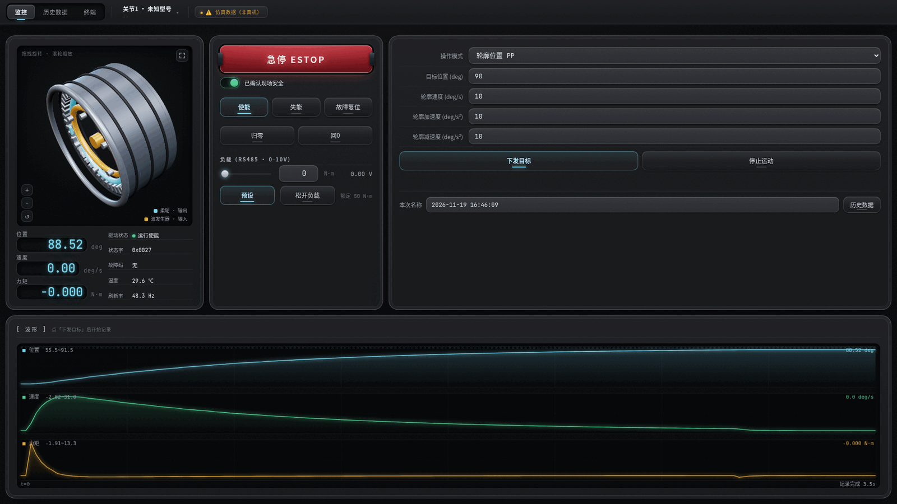
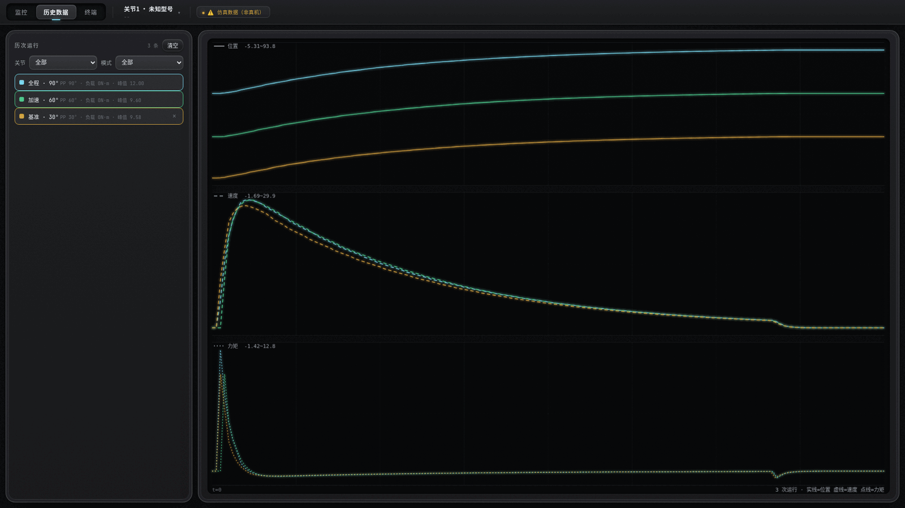
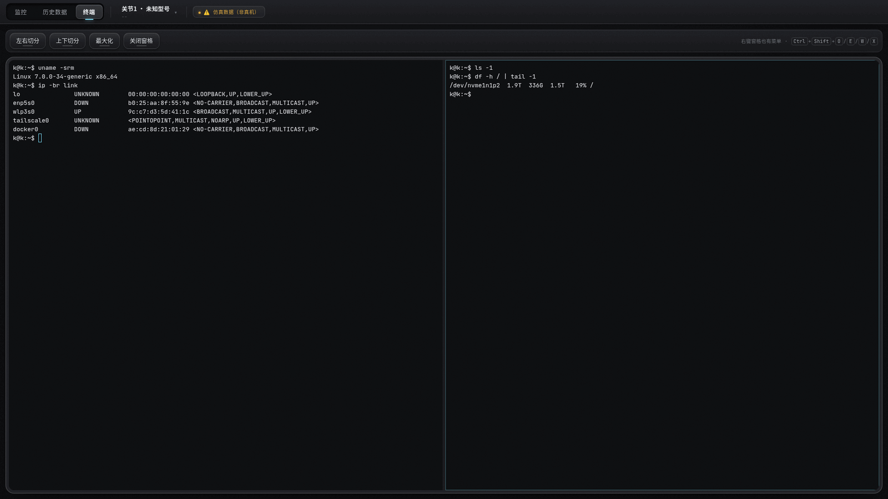
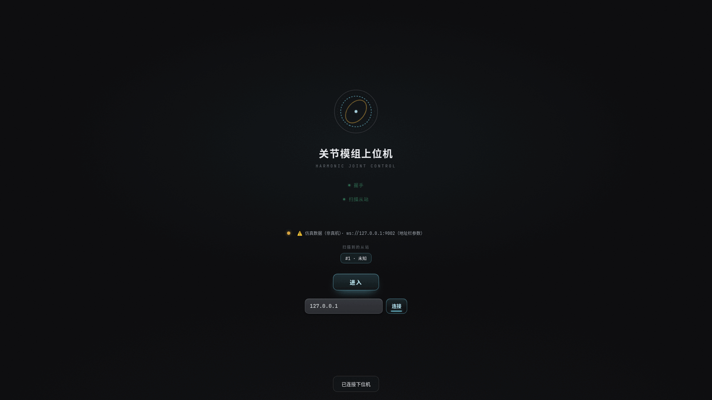

# 关节模组试验台

面向**职业教育**的关节模组（谐波减速关节）试验台软件。

下位机跑 EtherCAT 主站、直接驱动关节；界面全部在浏览器里 —— **下位机开机即用，不需要任何本地窗口或点击**。



## 三页界面

| | |
|---|---|
| **监控** — 三维关节、位置/速度/力矩大读数、遥测、急停与使能、模式与目标下发、实时波形 | **历史数据** — 按「关节 + 模式」筛选历次运行，叠加对比 |
|  |  |
| **终端** — Terminator 式切分，每格一个独立 shell（板子上的），用来排查现场问题 | **开场** — 连接 / 握手 / 扫描从站，逐行滚动 |
|  |  |

## 功能

- **双总线 + 仿真**：EtherCAT / CANopen 自动检测；没有硬件时回退仿真模式，界面照常可演示
- **三种轮廓模式**：PP 轮廓位置 / PV 轮廓速度 / PT 轮廓力矩（对齐官方例程）
- **多从站**：扫到几个关节就出几个，型号按驱动器自动识别（额定力矩/编码器分辨率/减速比随之确定）
- **安全**：
  - ±170° 行程限位（保护中空轴里的力矩传感器线束，禁止连续旋转）
  - 遥测看门狗：500ms 读不到数据即判定断连
  - **上位机离线即失能**：WS 断开、或心跳超 1s 没到 → 失能所有轴 + 撤负载
  - 急停任何时候都能发
- **波形**：点「下发目标」才开始记录本次响应，三窗格（位置/速度/力矩）各自自适应量程
- **历史对比**：存在浏览器本地 IndexedDB，跑完一次**必须明确选择保存或丢弃**；对比时「运行 = 颜色，轨迹 = 线型」
- **磁粉制动器负载**：RS485 → Modbus → 0-10V，与关节的 EtherCAT 是两条独立链路

## 架构

```
板子 / 工控机（Linux）                    任何一台机器
├─ Qt 下位机    EtherCAT 主站 + WS :9002   ┌──────────────┐
│   （无窗口，开机自动连上）                │   一个浏览器   │
└─ web/serve.py  静态 + 终端 :8080         └──────────────┘
                        ↑────── ws :8080/term ──────┘
```

**上位机侧什么都不用装** —— Windows / macOS / Linux / 平板都行，只要浏览器够新
（Chrome/Edge 89+、Firefox 108+、Safari 16.4+，需要 import map 和 WebGL2）。

推荐把 `web/serve.py` 也起在板子上：这样地址推导永远正确，而且终端页开出来的就是
**板子自己的 shell**。详见 [`DEPLOY.md`](DEPLOY.md) §3.5。

## 快速开始

```bash
# ① 构建（SDK 需放在本仓库的上一级，见下）
./build.sh

# ② 起下位机 —— 无窗口，自动检测总线并连上
sudo ./run.sh

# ③ 另开一个终端，起网页（普通用户，别用 sudo）
cd web && python3 serve.py
```

浏览器打开 <http://localhost:8080>。同网段任何一台机器也可以打开 `http://<本机IP>:8080`。

需要本地窗口（现场排查、挑仿真、换网卡）时：`sudo ./run.sh --ui`。

## 构建

**依赖**：Qt5 Widgets + Qt5 WebSockets 开发包、CMake ≥ 3.16、g++（C++17）。

> **SDK 不在本仓库内。** clone 后要把对应架构的 SDK 目录放到 `joint-gui` 的**上一级**
> （CMake 按 `../eyou_*_sdk_*_linux_gnu_*/` 查找）：
> ```
> <父目录>/
> ├── joint-gui/
> ├── eyou_ethercat_phu_sdk_<arch>_linux_gnu_20260708/
> └── eyou_canopen_sdk_PHU_<arch>_linux_gnu_20260710/
> ```

```bash
sudo apt install qtbase5-dev cmake g++ pkg-config
./build.sh              # x86 本机构建
./build.sh arm          # x86 上交叉编译出 aarch64（多架构工具链见 DEPLOY.md）
```

> SDK 库自带厂商构建机路径的 `DT_RUNPATH`，直接跑 `./build/joint_gui` 会找不到传递依赖
> （`libsoem.so` 等）。用 `./run.sh`，它会自动聚合 `LD_LIBRARY_PATH`。

## 部署

```bash
sudo apt install libqt5widgets5 libqt5gui5 libqt5core5a libqt5network5 libqt5websockets5
sudo ./run.sh           # EtherCAT 要 raw socket，所以 sudo
```

完整步骤（交叉编译、SDK 拷贝、setcap 免 sudo、浏览器界面部署、FAQ）见
[`DEPLOY.md`](DEPLOY.md)。

## 测试

```bash
ctest --test-dir build --output-on-failure      # C++ 单元测试

cd web
node tests/term_client.js                       # 终端后端（自己起 serve.py）
NODE_PATH=<playwright 的 node_modules> node tests/ui_term.js   # 终端页无头验证
NODE_PATH=<playwright 的 node_modules> node tests/ui_live.js   # 下位机 + 浏览器联调
```

## 目录

```
joint-gui/
├── src/                    下位机（Qt）
│   ├── core/               ControlWorker / ControlServer / LoadController
│   ├── device/             EtherCAT / CANopen / 仿真 三种实现
│   └── ui/                 本地窗口（只有 --ui 才构建）
├── web/                    上位机（纯静态 + 零依赖 Python 服务）
│   ├── serve.py            静态文件 + 终端，同端口
│   ├── server/             PTY 桥（手写 RFC 6455 WebSocket）
│   ├── js/ css/            监控 / 历史 / 终端三页
│   └── tests/              三套自动测试
├── tools/                  诊断工具（eth_probe / read_joint_params / watch_torque）
└── docs/                   架构设计、终端页设计、参数读取
```

## 文档

| 文档 | 内容 |
|---|---|
| [`USAGE.md`](USAGE.md) | 界面使用说明、操作模式、安全功能 |
| [`DEPLOY.md`](DEPLOY.md) | 构建、部署、权限、常见问题 |
| [`docs/host-embedded-architecture.md`](docs/host-embedded-architecture.md) | 上下位机分工、协议、看门狗 |
| [`docs/terminal-page-design.md`](docs/terminal-page-design.md) | 终端页设计（Terminator 式切分） |
| [`web/README.md`](web/README.md) | 网页端：启动、终端页、控制逻辑 |
| [`docs/joint-param-reading.md`](docs/joint-param-reading.md) | 关节参数读取与 CiA402 OD 要点 |

## 许可

[Apache License 2.0](LICENSE)。
